# MorningConnect

지하철 같은 칸 사람끼리 자리를 이어받는 안드로이드 앱 (Kotlin · XML + ViewBinding)

## 화면

### 홈 · 원형 메뉴

| 홈 | ① 오늘의 룩 | ② 오픈톡 |
|:---:|:---:|:---:|
| 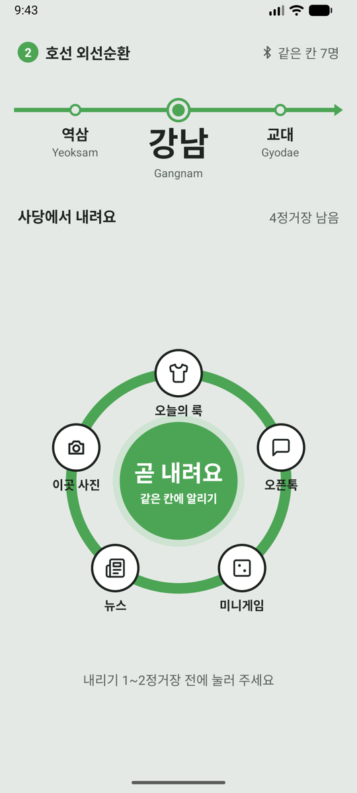 | 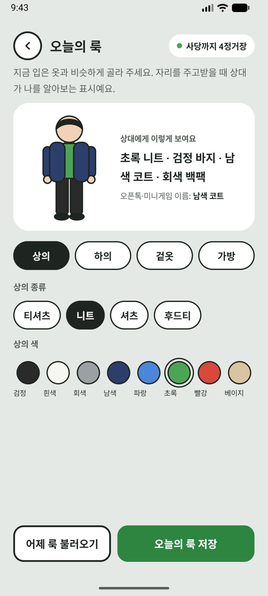 | 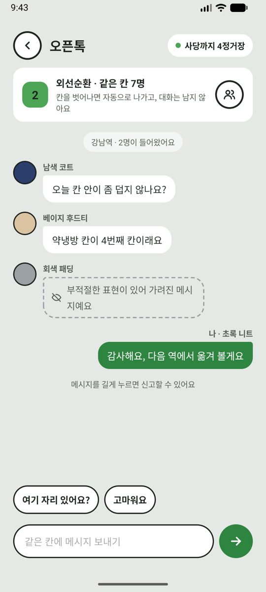 |

| ③ 미니게임 · 자리 알림 | ③ 알림 수락 후 | ④ 뉴스 · 하차 알림 |
|:---:|:---:|:---:|
| 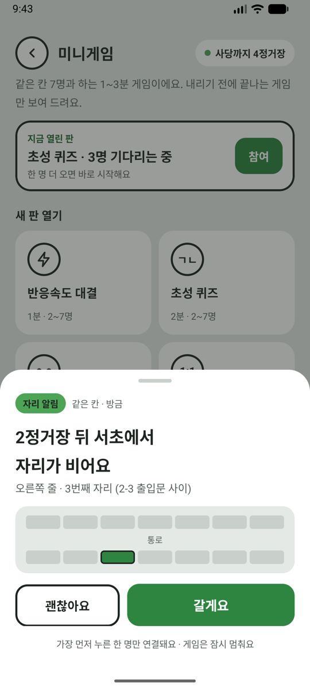 | 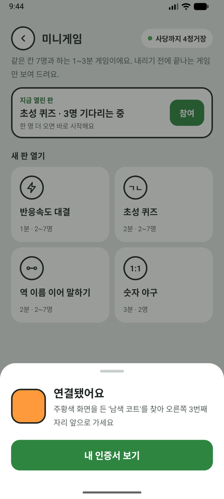 | 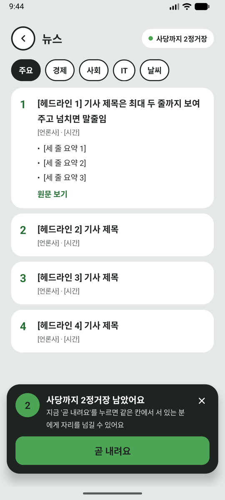 |

| ⑤ 이곳 사진 |
|:---:|
| 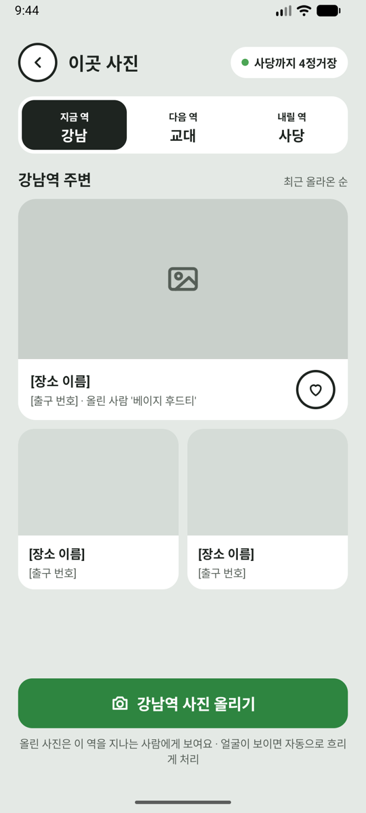 |

### 곧 내려요 (자리 넘기기)

| 1 · 자리 위치 선택 | 2 · 같은 칸에 알림 | 3 · 서로 찾기 + 하차 재확인 |
|:---:|:---:|:---:|
| 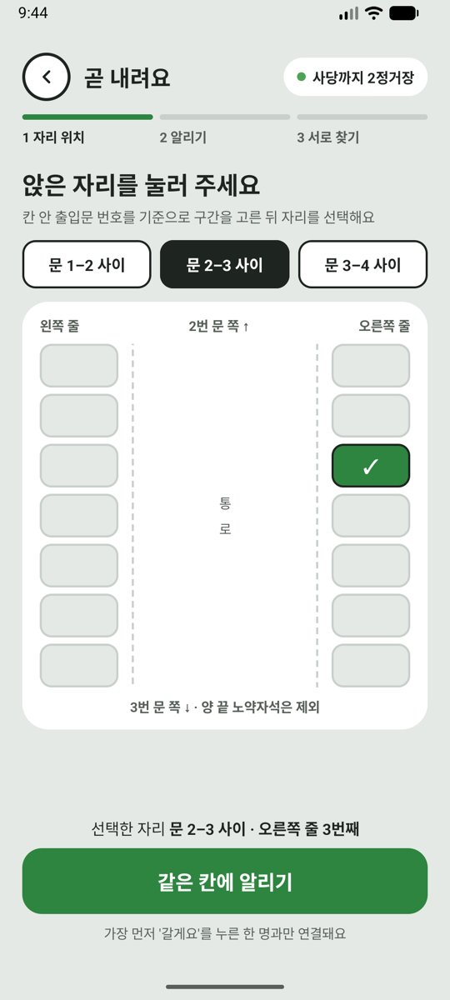 | 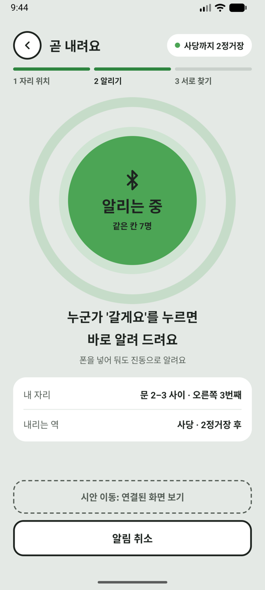 | 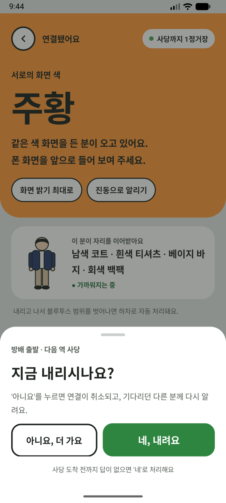 |

| 3 · 연결 취소 | 4 · 인증서 확인 | 4 · 인계 완료 |
|:---:|:---:|:---:|
| 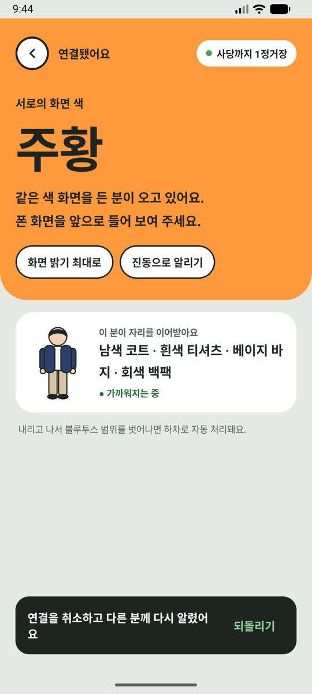 | 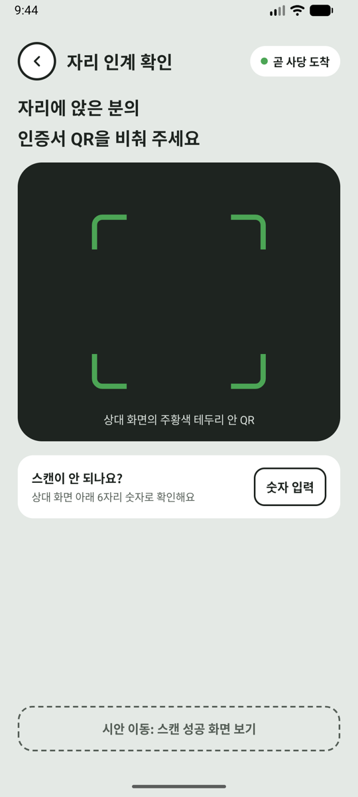 | 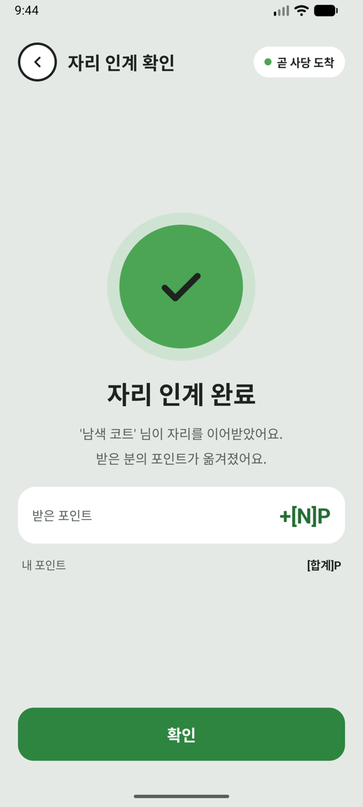 |
