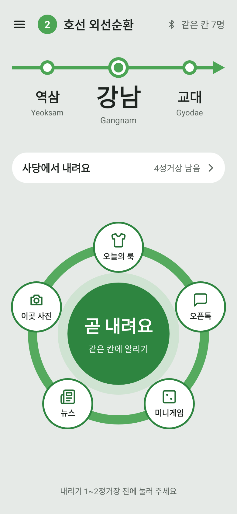
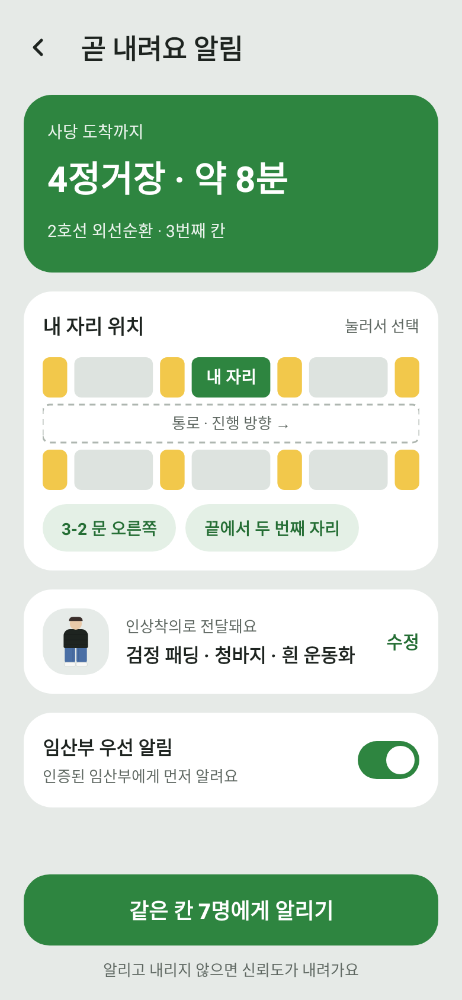
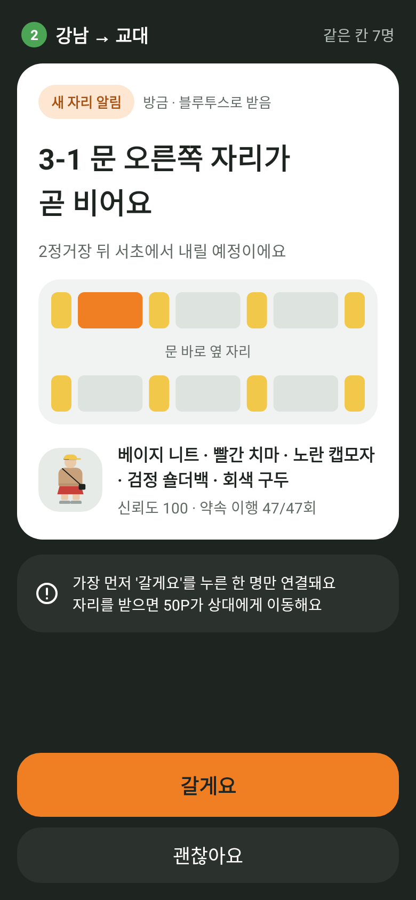
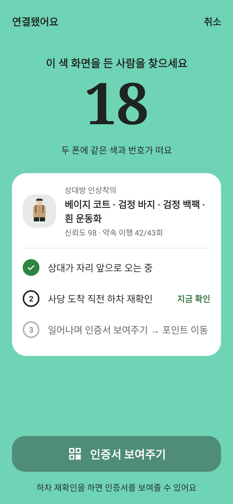
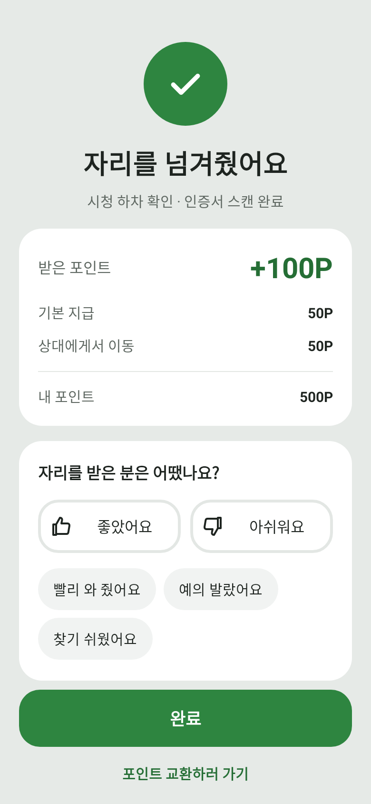
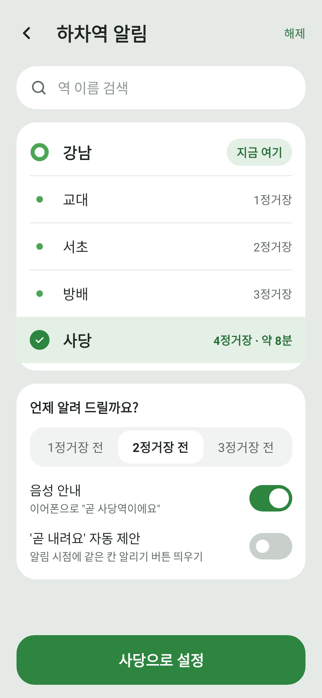
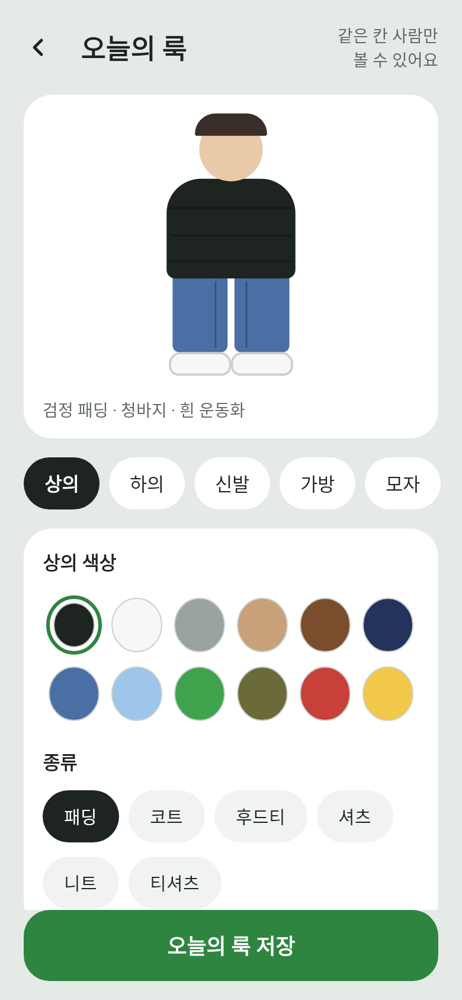
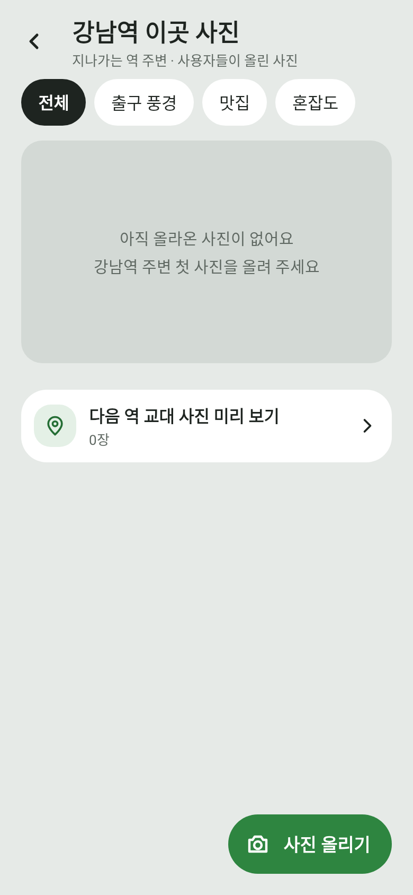
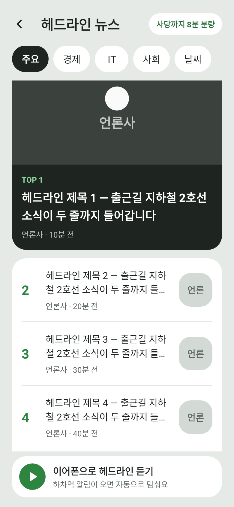
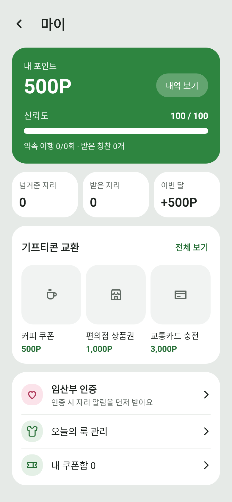

# MorningConnect

지하철 같은 칸 사람끼리 자리를 이어받는 안드로이드 앱 (Kotlin · XML + ViewBinding)

## 화면

| 홈 | 곧 내려요 알림 | 새 자리 알림 (받는 쪽) | 연결됐어요 |
|:---:|:---:|:---:|:---:|
|  |  |  |  |

| 인계 완료 | 하차역 알림 | 오늘의 룩 | 이곳 사진 |
|:---:|:---:|:---:|:---:|
|  |  |  |  |

| 헤드라인 뉴스 | 마이 |
|:---:|:---:|
|  |  |

> 스크린샷은 `./gradlew testDebugUnitTest --tests '*ScreenshotTest*'` 로 다시 만들 수 있어요 (`app/build/screens/`).

## 기능

| 화면 | 구현 내용 |
|---|---|
| 홈 | 스크롤 없는 고정 화면(화면 크기에 맞춰 원형 메뉴 크기 조절). 2호선 43개 역 기준 지금·이전·다음 역(다음 역까지 진행 점), 하차역까지 남은 정거장. 원형 메뉴 5개는 손가락으로 원을 따라 돌릴 수 있고 놓으면 가까운 자리에 맞춰 멈춤. 왼쪽 위 메뉴 버튼 → 마이. 노선명을 누르면 외선/내선 전환 |
| 하차역 알림 | 역 검색, 진행 방향 순서 목록, 1~3정거장 전 알림. `AlarmManager` 로 시각을 예약해 알림을 띄우고, 이어폰이 연결돼 있으면 TTS 로 "곧 ○○역이에요". 자동 제안을 켜면 알림에 '같은 칸에 알리기' 버튼. 재부팅 후 다시 예약. 역을 길게 누르면 지금 위치를 그 역으로 보정 |
| 곧 내려요 알림 | 좌석 배치도에서 내 자리 선택(목록 선택도 가능), 칸 번호, 오늘의 룩 인상착의, 임산부 우선 알림 → 같은 칸에 알리고 '갈게요' 기다리기 |
| 새 자리 알림 | 넘겨주는 사람의 자리·인상착의·신뢰도 표시. '갈게요' 를 누르면 연결 (포인트 50P 필요) |
| 연결됐어요 | 두 폰에 같은 색·번호(세션에서 계산). 넘겨주는 사람: 하차 1정거장 전 하차 재확인 → 인증서 QR 보여주기. 받는 사람: QR 스캔(카메라) 또는 번호 입력으로 확인. 인증서는 세션 비밀값 HMAC 서명이라 다른 연결의 QR 은 거절. 연결 후 취소하면 약속 불이행으로 신뢰도 하락 |
| 인계 완료 | 넘겨준 사람 +100P(기본 50 + 상대에게서 50), 받은 사람 -50P. 상대 평가(좋았어요/아쉬워요 + 태그) |
| 오늘의 룩 | 상의·하의·신발·가방·모자 × 12색 × 종류. 캐릭터가 바로 바뀌고, 저장한 룩이 인상착의 문장으로 전달됨 |
| 이곳 사진 | 지금 역/다음 역 사진, 분류(출구 풍경·맛집·혼잡도), 카메라 촬영·앨범 선택 업로드(긴 변 1600px로 줄이고 방향 보정), 대표 사진(좋아요 순), 좋아요·삭제 |
| 헤드라인 뉴스 | 구글 뉴스 RSS(주요·경제·IT·사회·날씨), 마지막 목록 저장(신호 끊겨도 표시), 당겨서 새로고침, 기사 열기. 하차역까지 남은 시간만큼 TTS 로 읽기 — 하차역 알림이 오면 자동으로 멈춤 |
| 마이 | 포인트·신뢰도(약속 이행률)·넘겨준/받은 자리·이번 달 적립, 포인트 내역, 기프티콘 교환(포인트 차감 + 쿠폰 코드·바코드), 내 쿠폰함, 임산부 인증, 오늘의 룩 관리 |

### 이번 범위에서 제외 · 대신한 부분

- **주변 유저 찾기(블루투스)** — BLE 광고만으로(연결 없이) 같은 칸 사람과 자리 알림 · '갈게요' · 하차 재확인 · 인증 결과를 주고받습니다 (`BleSeatNetwork`). 앱을 닫아도 포그라운드 서비스(`SeatService`)가 계속 찾고, 새 자리 알림이 오면 알림을 띄웁니다. 서비스 알림의 '끄기'로 멈추고 앱을 다시 열면 다시 켜집니다.
  - 블루투스 권한이 없거나 꺼져 있으면 `SimulatedSeatNetwork` 가 상대방 역할을 대신합니다. 홈의 **"블루투스 꺼짐"** 을 눌러 켜거나 받는 쪽 화면을 체험할 수 있어요.
  - 에뮬레이터 두 대를 띄우면 가상 블루투스(netsim)로 서로 찾습니다.
- **열차 위치** — 지하에서는 GPS 가 잡히지 않아 실제로는 역사 비콘 등이 필요합니다. 지금은 출발역 + 역당 2분으로 계산합니다(`TrainClock`).
- **오픈톡 · 미니게임** — 제외. 홈 메뉴에는 남겨 두고 "준비 중" 안내만 띄웁니다.
- 서버가 없어서 사진·평가·임산부 인증은 기기 안에만 저장됩니다. 첫 실행 시 가입 축하 500P 를 줍니다.

## 구조

```
app/src/main/java/com/example/morningconnect/
├─ Line2.kt          2호선 역 목록 · TrainClock(열차 위치) · 조사 처리
├─ Store.kt          SharedPreferences 저장소 (포인트·내역·신뢰도·룩·하차역·쿠폰…)
├─ Look.kt           오늘의 룩 모델
├─ Handoff.kt        자리 인계 세션 · 좌석 · 인증서(HMAC) 
├─ SeatNetwork.kt    같은 칸 통신 인터페이스 + 시뮬레이션 구현
├─ BleSeatNetwork.kt BLE 광고 메시지 형식 · BLE 구현
├─ SeatService.kt    백그라운드에서 같은 칸 찾기 (포그라운드 서비스) · 자리 알림
├─ ArrivalAlarm.kt   하차역 알람 예약 · 알림 · 수신기
├─ Speaker.kt        TTS (하차 안내 / 뉴스 읽기 공용)
├─ NewsRepo.kt       구글 뉴스 RSS
├─ PhotoRepo.kt      역별 사진 저장
├─ CharacterView.kt  룩 캐릭터 그리기
├─ SeatMapView.kt    좌석 배치도
├─ OrbitMenu.kt      돌릴 수 있는 원형 메뉴
└─ *Activity.kt      화면
```

## 빌드 · 테스트

```bash
./gradlew assembleDebug
./gradlew testDebugUnitTest   # 로직 · 전체 흐름 · 스크린샷 (Robolectric)
```
